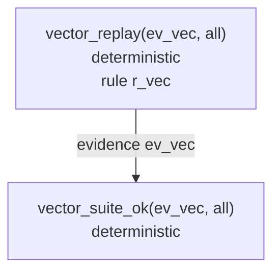
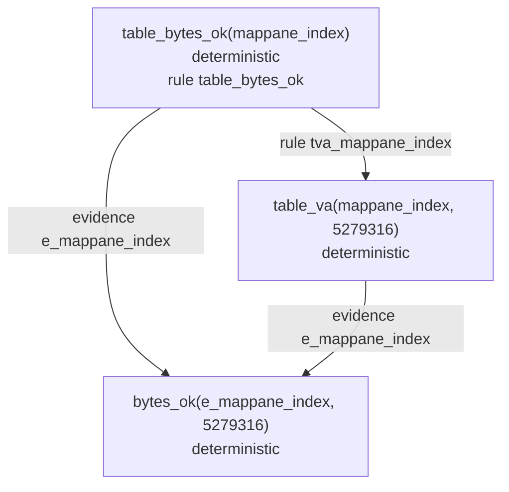

# deg-nexustk — the NexusTK 7.52 adapter for DeG

[](https://github.com/Sureiya/deg-nexustk/actions/workflows/ci.yml)

`deg-nexustk` is a standalone crate that consumes the [DeG proof
checker](https://github.com/Sureiya/deg) as a library (git dependency, `main`
branch). It compiles three reviewed evidence extensions into a second trusted
binary (`deg-nexustk`) that extends the kernel with NexusTK-specific checks,
and it adds the `generate` lane that turns the project's audit artifacts into
a checked model. The core `deg` binary is unchanged and registers none of
them: a model that names `ntk_vector` under the core binary fails loudly with

```text
evidence kind `ntk_vector` is not registered; registered: [...]
```

while `deg-nexustk extensions` lists exactly `ntk_bundle`, `ntk_frames`,
`ntk_vector`.

Everything here is implemented from the documented 7.52 algorithms (key-table
MD5 chain, temp key, per-direction tail bytes, the self-inverse 3-stage XOR
body transform, `AA len(u16BE) op [inc] body [tail]` framing, and the
documented cipher policy). No file, vector value, key-table prefix, or fixture
was copied from the KazeTK project: the committed synthetic fixtures are
generated in-repo by an independent Python implementation
(`tools/gen_fixtures.py`), so they cross-check this code instead of
echoing it.

## What it does, in one picture

Architecture: operator artifacts on the left, the three compiled-in evidence
kinds in the middle, the proof graph on the right.

````mermaid
flowchart TD
    OP1["kaze.bundle/v1 packages"] --> ntk_bundle
    OP2["frames.jsonl captures"] --> ntk_frames
    OP3["known-answer 7.52 vectors"] --> ntk_vector
    OP4["NexusTK client (.exe)"] --> core["core deg evidence<br/>build · bytes · scan · dataset"]
    ntk_bundle --> facts["facts, strength-tagged<br/>deterministic / observational"]
    ntk_frames --> facts
    ntk_vector --> facts
    core --> facts
    facts --> claims["proofs · coverage<br/>conflicts · decisions"]
    claims --> seal["seal / lock"]
    claims --> port["port · report"]
````

The `generate` lane: audit JSONs and the client in, a checked model out.

````mermaid
flowchart LR
    A["DISPATCHER-AUDIT.json"] --> GEN
    B["opcode-layouts.json"] --> GEN
    C["opcode-artifacts.json"] --> GEN
    D["7.52 vectors.json"] --> GEN
    E["client .exe"] --> GEN
    GEN["deg-nexustk generate"] --> OUT["model.dg<br/>datasets · decision templates"]
    OUT --> CHK["deg-nexustk check"]
    CHK --> SEAL["seal / lock"]
    CHK --> REP["report · crosscheck parity"]
````

## See it work — synthetic (runs anywhere)

Everything below runs against the committed synthetic fixtures
(`examples/synthetic/`, generated by `tools/gen_fixtures.py`) — no operator
files needed, and every pasted output is re-run and diffed byte-for-byte by
`tools/verify_readme.py`. A numbered end-to-end walkthrough, including the
operator-local lanes, lives in [docs/demo.md](docs/demo.md).

Check the model:

```console
$ cargo run -q -- check examples/synthetic/model.dg
deg check examples/synthetic/model.dg
  artifacts   5 (5 verified)
  evidence    3 (3 ok)
  claims      3 sealed, 0 provisional, 1 hypothesis, 0 failed/refuted
  obligations 0 open
  conflicts   0 (0 unresolved)
  decisions   0 (0 ok)
  threshold   deterministic

claims:
  ✓ C_adapter                    sealed       deterministic  adapter_sealed(ntk_syn)
      bottleneck: P_vectors
  ✓ P_bundle                     sealed       deterministic  bundle_seen(ev_bundle, bnd_deg_synthetic_752)
  ? P_frames                     hypothesis   observational  frame_seen(ev_frames)
      note: strength observational is below the seal threshold deterministic
  ✓ P_vectors                    sealed       deterministic  vector_replay(ev_vec, all)

kernel: OK
```

The derivation of `P_vectors`, as a Mermaid flowchart (`deg explain --mermaid`):

````console
$ cargo run -q -- explain examples/synthetic/model.dg P_vectors --mermaid

````

The adapter registers exactly three evidence kinds:

```console
$ cargo run -q -- extensions
ntk_bundle
ntk_frames
ntk_vector
```

Seal it — the lock is deterministic (byte-identical across runs) and is
committed as `examples/synthetic/model.lock.json`:

```console
$ cargo run -q -- seal examples/synthetic/model.dg --out /tmp/show.lock.json
sealed 3 claim(s) (0 provisional) into /tmp/show.lock.json
recorded 1 hypothesis/hypotheses: P_frames
```

The committed lock in summary (`P_vectors` and `P_bundle` seal Deterministic;
`P_frames` is recorded as an Observational hypothesis by design):

```json
{
  "artifact_count": 5,
  "model": "examples/synthetic/model.dg",
  "deg_version": "0.1.0",
  "seal_threshold": "deterministic",
  "sealed": ["C_adapter", "P_bundle", "P_vectors"],
  "hypotheses": ["P_frames"],
  "obligations": []
}
```

## See it work — against the real artifacts (operator-local, never in CI)

<!-- verify-skip -->

This section depends on the operator's client binary and the emulator checkout
at `/home/kin/nexustk-emulator`. Nothing here is committed, copied into this
repository, or run in CI; the excerpts are a snapshot from one machine and one
day, and the numbers shift as the project's audits and captures change.

Generate the model (the project files are read in place; only `--out` is
written):

```console
$ cargo run -q -- generate \
    --client /home/kin/.local/share/kazetk/vanilla-client/NexusTK.exe \
    --dispatch /home/kin/nexustk-emulator/docs/analysis/opcodes/DISPATCHER-AUDIT.json \
    --layouts /home/kin/nexustk-emulator/ops/conductor/opcode-layouts.json \
    --artifacts /home/kin/nexustk-emulator/docs/analysis/opcodes/artifacts.json \
    --vectors /home/kin/nexustk-emulator/server/internal/protocol/testdata/vectors/7.52.json \
    --out /tmp/opencode/ntk-readme
```

Check the generated model — 46 sealed proofs (18 dispatch-table byte checks +
28 vector-opcode proofs), 10 hypotheses, 54 open obligations:

```text
deg check /tmp/opencode/ntk-readme/model.dg
  artifacts   5 (5 verified)
  evidence    21 (21 ok)
  claims      46 sealed, 0 provisional, 10 hypothesis, 0 failed/refuted
  obligations 54 open
  conflicts   0 (0 unresolved)
  decisions   0 (0 ok)
  threshold   deterministic
```

The coverage claim reports the graph instead of deciding it:

```text
claims:
  ? C_cov                        hypothesis   deterministic  coverage(ds_ops, target:82)
      note: covered 28/82; missing: 0x1, 0x6, 0xe, 0xf, 0x12, 0x1a, 0x1d, 0x21, 0x22, 0x23, 0x24, 0x25, 0x26, 0x29, 0x30, 0x32, 0x34, 0x37, 0x3a, 0x3b, 0x3f, 0x40, 0x42, 0x43, 0x44, 0x45, 0x46, 0x4a, 0x4d, 0x4f, 0x50, 0x51, +22 more
      bottleneck: P_op_00
      coverage: 28/82 covered; missing: 0x1, 0x6, 0xe, 0xf, 0x12, 0x1a, 0x1d, 0x21, 0x22, 0x23, 0x24, 0x25, 0x26, 0x29, 0x30, 0x32, 0x34, 0x37, 0x3a, 0x3b, 0x3f, 0x40, 0x42, 0x43, 0x44, 0x45, 0x46, 0x4a, 0x4d, 0x4f, 0x50, 0x51, +22 more
```

The `--mermaid` derivation for one sealed dispatch-table proof:

````markdown

````

Nine decision templates — one per artifact id — are emitted for a human to
fill in (`signer`/`reason`) and hash-pin:

```console
$ ls /tmp/opencode/ntk-readme/decisions/
79.txt
80.txt
93.txt
96.txt
9b.txt
a0.txt
aa.txt
fe.txt
ff.txt
```

The operator-local parity crosscheck (`tools/crosscheck.py`) re-runs generate
+ `check --json` and prints the same numbers next to the ids the project files
themselves list:

```text
crosscheck parity table (informational; the DeG check itself passed)
==============================================================================
coverage: 28/82 covered
missing (from the layouts universe): 0x1, 0x6, 0xe, 0xf, 0x12, 0x1a, 0x1d, 0x21, 0x22, 0x23, 0x24, 0x25, 0x26, 0x29, 0x30, 0x32, 0x34, 0x37, 0x3a, 0x3b, 0x3f, 0x40, 0x42, 0x43, 0x44, 0x45, 0x46, 0x4a, 0x4d, 0x4f, 0x50, 0x51, 0x57, 0x5e, 0x5f, 0x60, 0x61, 0x64, 0x66, 0x67, 0x69, 0x74, 0x75, 0x77, 0x79, 0x7b, 0x80, 0x93, 0x96, 0x9b, 0xa0, 0xaa, 0xfe, 0xff
layouts file ids: 82 distinct
artifact ids (9): 0x79, 0x80, 0x93, 0x96, 0x9b, 0xa0, 0xaa, 0xfe, 0xff
artifact ids present in the layouts universe: 0x79, 0x80, 0x93, 0x96, 0x9b, 0xa0, 0xaa, 0xfe, 0xff
sealed claims: 46; hypotheses: 10; obligations: 54
==============================================================================
```

`deg port --markdown` (a new core flag) re-anchors claims across client
builds and marks the rest stale. Here a scratch copy of the generated model
adds a second build declaration over the same operator client, so the
table-byte proofs port (`reused`) while the vector and artifact claims are
flagged for revalidation:

```text
# DeG port report — `/tmp/opencode/ntk-port-demo/model.dg` → `ntk2`

## Mappings

| Kind | Name | Old | New | Similarity | How |
|---|---|---|---|---|---|

## Claims

| Claim | Source build | Action | Status | Strength | Notes |
|---|---|---|---|---|---|
| `P_art_79` | `ntk` | stale | stale | - | stale: `e_art`: table evidence is dataset-bound; revalidate it against a target dataset |
| `P_mappane_index` | `ntk` | reused | ported | deterministic → deterministic |  |
| `P_op_00` | `ntk` | stale | stale | - | stale: `e_vec`: extension evidence cannot be ported automatically; re-derive it for the target build |
… the remaining 52 claim rows elided; the full report ends with one `revalidate` obligation per stale claim …
```

On another machine these numbers differ — or the lane fails outright when the
operator-local files are absent.

## Why this exists

The NexusTK emulator project has accumulated thousands of half-verified
protocol claims — opcode tables, dispatch ranges, packet layouts, the
nine-artifact dossier — mostly as prose in markdown docs and JSON audits.
`deg-nexustk` turns that prose into a machine-checked graph: every claim
bottoms out in hashed artifacts, every fact is re-derived by the kernel (or
visibly capped at Observational when it is someone's written analysis), and
every gap becomes a named, open obligation. The result is a `check` that
reports sealed/hypothesis/obligation strengths instead of trusting a script, a
`seal` that is reproducible byte-for-byte, and a cross-version `port` that
re-anchors what it can and marks the rest stale. The hook is the nine-artifact
conflict: nine opcodes sit in the layout universe but are classified as parser
artifacts by the project's dossier, so the generator emits a capped hypothesis
claim and a human decision template for each — the boundary between observed
and assumed becomes machine-visible instead of a footnote. When someone edits
a number, the seal breaks; when a patch ships, the port report says exactly
what to re-verify.

## Evidence kinds

### `ntk_vector(ds_name, [suite: ...])` — Deterministic

Replays a known-answer vector file (declared as a content-addressed `dataset`)
and re-derives every answer from the documented algorithm:

- `keytables`: the 1024-byte MD5-chain table for the declared identity has the
  declared length/prefix, is ASCII hex, and is deterministic;
- `tempkeys`: `KeyTable(identity).TempKey(b8, w16)` equals the declared key;
- `ciphers`: the per-frame key comes from the declared identity (empty = the
  static key, non-empty = the name table via the decoded tail); the produced
  ciphertext matches the full value, or the declared `ciphertext_len` /
  `ciphertext_sha256` / `ciphertext_prefix`; the transform round-trips;
- `frames`: the wire bytes (`AA/len/opcode/inc/body/tail`; raw layouts carry
  no tail, and plain/raw frames carry the body verbatim) are reconstructed and
  compared byte-for-byte; the declared `raw`/`plaintext_body` flags must agree
  with the documented layout and policy;
- `streams`: the wire is split into frames, bodies decrypted, and the parsed
  list (opcode/increment/plaintext/tail/raw) plus the consumed byte count are
  compared;
- `errors`: the codec must reject the wire (any framing error class); for
  body-length vectors the encoder must reject the oversized frame.

`suite:` is one of `keytables`, `tempkeys`, `ciphers`, `frames`, `streams`,
`errors`, or `all` (the default). The first mismatch fails the evidence with
the suite name, the vector name, and the expected vs actual hex (bounded: large
bodies are never dumped whole). On success the facts are
`vector_suite_ok(ev, suite)`, `vector_count(ev, suite, n)`, and one of
`keytable_ok(ev, name)` / `tempkey_ok(ev, name)` /
`cipher_vector_ok(ev, name, dir, opcode)` /
`frame_vector_ok(ev, name, dir, opcode)` /
`stream_vector_ok(ev, name, dir)` / `error_vector_ok(ev, name)` per vector:
cipher and frame facts carry the vector's declared direction (`c2s`/`s2c`, `""`
when absent) and opcode, stream facts carry the direction, and the key-table,
temp-key, and error facts stay 2-ary.

### `ntk_frames(ds_name, [max_frames: n])` — Observational

Reads a `frames.jsonl` capture dataset (one JSON object per line) and emits
**structural facts only**: `frame(ev, dir, op, channel, body_len, ts)` where
`dir` is `in`/`out`, `op` is the integer opcode (0 when absent), `channel` is a
symbol (empty when absent), `body_len` is the declared body length
(`bodyDeclaredLen`, else the captured byte count `bodyHexCaptured`, else the
hex-char count of `bodyHex`; 0 when none is present — real captures truncate
`bodyHex` with a `…<N>` marker), and `ts` is the capture timestamp in
microseconds (0 when absent; the schema records epoch milliseconds). Rows
whose `event` field exists and is not `"frame"` (connect/close/logger
bookkeeping) are skipped, as are lines that are not JSON objects; both are
counted in a detail. `frame_count(ev, n)` is emitted, and `max_frames:` fails
the evidence when exceeded.

Bodies are **never** emitted into facts or details; the outcome records the
redaction note. The strength is Observational: the dataset is a
capture-derived observation, not something this evaluator re-derives from
verified bytes.

### `ntk_bundle(manifest_ds, bundle_id, [index_ds: name])` — Deterministic

Verifies the `kaze.bundle/v1` layout documented for the capture pipeline:

1. the manifest is JSON, and the SHA-256 of its canonical form (sorted keys,
   compact `,`/`:` separators, non-ASCII raw) with **both** the `seal` and
   `verify` keys removed equals the reference digest — otherwise
   "manifest verify digest mismatch";
2. when `index_ds` is declared, the index must contain a package entry for
   `bundle_id` whose `manifest_sha256` (the raw manifest bytes) and
   `seal_sha256` (the reference digest) match — without an index the hash
   chain is unpinned and a detail says so;
3. the manifest's `evidence` entry names a file next to the manifest whose
   SHA-256 matches;
4. the manifest's `files` entries (when present) each name a file next to
   the manifest whose SHA-256 matches;
5. every `blobs` entry resolves to `blobs/sha256/<aa>/<bb>/<sha256>`
   relative to the manifest directory (with `<aa>`/`<bb>` the digest's first
   bytes), the file exists, and its content hash equals the name.

Two schema generations are accepted. The **live** manifests carry
`seal: {algorithm, sha256}`, a `bundles` index array, and blob entries that
are objects with `sha256`/`kind`/`bytes`/`source_ref` and no `path` (the
canonical path is derived from the digest). The **documented** schema
describes `verify: {algorithm, sha256}`, a `packages` index array, and blob
entries that carry their `path` directly. Both are accepted — the verifier
errors only when neither `seal.sha256` nor `verify.sha256` exists, and the
reference digest always drops both keys. When a blob entry carries both
`path` and `sha256`, they must agree.

Paths resolve relative to the manifest dataset's file location
(`artifacts.items[manifest_ds].resolved_path.parent()`); blob paths and
`files` paths may not escape the bundle directory. Unknown/absent optional
fields are tolerated and noted. Facts: `bundle_verified(ev, bundle_id,
manifest_sha)`, `bundle_entries(ev, n)`, `bundle_blobs(ev, n)`,
`bundle_evidence_ok(ev, path)`, and `blob_ok(ev, index, sha)` per blob.

## Trust model and strength rules

The adapter follows `docs/extensions.md` exactly. The three evaluators are
compiled into the trusted `deg-nexustk` binary, are bound to verified
(content-addressed) datasets, and assign strength by the same invariant as the
core primitives:

- `ntk_vector` and `ntk_bundle` **re-derive** their facts from verified bytes
  (the codec replay and the hash chain), so they are Deterministic;
- `ntk_frames` admits capture-derived observations, so it is capped at
  Observational;
- nothing here reaches Exact.

The compiled-in code is the extension of the trusted kernel: review it like a
change to `evidence.rs`. A binary with extensions has a larger trusted surface
than the core binary, which is why `deg extensions` exists and why the core
binary registers nothing.

**Redaction:** packet bodies, key tables, temp keys, character names, and any
credential material are never emitted into facts or details. Facts carry
structure (opcodes, lengths, timestamps, counts, content hashes) only. Error
messages show bounded hex previews, never whole bodies.

## Usage

```console
$ cargo run -q -- extensions
ntk_bundle
ntk_frames
ntk_vector

$ cargo run -q -- check examples/synthetic/model.dg
$ cargo run -q -- explain examples/synthetic/model.dg P_vectors
```

The synthetic model declares the generated fixtures (`vectors-synthetic.json`,
`frames-synthetic.jsonl`, the `bundle/` layout, and a synthetic build image)
with real SHA-256 values, then proves the vector replay, a frame fact, and the
bundle verification. The first two claims seal at Deterministic; the frames
proof stays an Observational hypothesis by construction. Regenerate the
fixtures (and `model.dg`) with:

```console
$ python3 tools/gen_fixtures.py
```

The generator is deterministic and idempotent, so a regenerated tree must
match the committed one exactly.

## `generate` — from audit artifacts to a checked model

`deg-nexustk generate` converts the project's audit artifacts into a
deterministic `.dg` model plus content-addressed copies of the tabular inputs,
decision templates, and a provenance README. It is part of the adapter binary
itself, and everything else on the command line still falls through to the
core `deg` CLI unchanged.

```console
$ deg-nexustk generate --out <dir> \
    [--client <exe>] [--client-sha <hex>] \
    [--vectors <7.52.json>] \
    [--layouts <opcode-layouts.json>] \
    [--dispatch <DISPATCHER-AUDIT.json>] \
    [--artifacts <opcode-artifacts.json>] \
    [--anchors <anchors.json>] \
    [--target <n>] [--port-to <client2>]
```

The generator writes only inside `--out` (which must not exist yet or be an
empty directory). Inputs are read, never modified, and nothing from them is
copied into this repository.

What each input produces:

- `--client`: the `build ntk = binary(…, format: pe)` declaration. The digest
  is `--client-sha` when given (checked against the file) or computed; the
  `arch:` is decided by parsing the PE (`x86`/`x86_64`). Without a client the
  build declaration is a commented placeholder and all client-backed evidence
  and proofs are skipped.
- `--vectors`: a byte-exact copy `vectors.json`, `dataset ds_vec`, and
  `ev e_vec := ntk_vector(ds_vec, suite: "all")`. The rules
  `opcode_from_vector`/`opcode_from_cipher` turn the per-vector facts into
  ground `opcode(?op)` facts, and one proof `P_op_<hex>` is emitted per opcode
  the vectors exercise. These seal at Deterministic.
- `--dispatch`: a generated `table-cases.csv` (one `index` and one `case` row
  per table with the audit's VAs and file offsets) parsed as `table` evidence,
  plus one `bytes` evidence per row re-reading the declared table bytes from
  the client. `table_va` assignments are derived from the matching bytes
  evidence and feed the shared `table_bytes_ok` rule, so each
  `P_<table>_<kind>` proof is kernel-replayed and seals at Deterministic.
- `--layouts`: `opcodes.txt` with every numeric opcode id mentioned anywhere
  in the file (deduplicated, decimal), `dataset ds_ops`, an
  `obligation O_observe_<hex> : observe_opcode(<id>) priority: high;` per id
  without a vector proof, and a coverage claim
  `claim C_cov : coverage(ds_ops, target: <n>) in ntk from <vector proofs>;`
  (target defaults to the distinct id count). When no vector proofs exist an
  `O_coverage` obligation is emitted instead.
- `--artifacts`: `artifacts.csv` (id + role rows from the manifest), a capped
  rule per id (`rule art_<hex> cap observational: artifact(<id>) if
  row(e_art, <idx>, ?cells) and contains(?cells, "<role>");`), and a proof
  `P_art_<hex>` that stays an Observational **hypothesis** by construction —
  the CSV content is the project's analysis, not a kernel-replayed fact. Each
  id also gets a decision template `decisions/<hex>.txt` and a commented-out
  `decision`/`conflict` pair naming the real `P_op_<hex>`/`P_art_<hex>`
  claims. The template uses the claim-name form the decision declaration
  needs — `prefer: P_art_<hex>` / `over: P_op_<hex>` / `signer:
  OPERATOR-PENDING` / `reason: <role>` / `note: P_op_<hex> needs its own
  evidence first (see the commented block in model.dg)` — and a human fills
  the file, records its sha256, and uncomments the two lines.
- `--anchors`: a small JSON array of
  `{"name", "va", "bytes", "section"}` entries. Each becomes
  `fn <name> in ntk at <va>;`, a unique `scan` evidence, and a proof
  `P_<name> : anchored(<name>, <va>)` via the `anchored_at` rule — the
  standard DeG anchor pattern, sealing at Deterministic when the prologue is
  unique.
- `--port-to <client2>`: a commented `port from ntk to ntk2 { … }` template
  with one `rebase` line per anchor.

Strength discipline: only kernel-replayed facts (bytes, scans, dataset
parses, the vector replay) reach Deterministic; generator-authored
interpretation is capped Observational (the artifact rules) or left open as
obligations and commented-out decisions; nothing reaches Exact. The generated
`README.md` records the provenance and the exact check/seal commands.

## Crosscheck tooling (operator-local, never in CI)

`tools/crosscheck.sh` (wrapping `crosscheck.py`) runs the generate
lane against the **real** project artifacts — read-only from the checkout at
`/home/kin/nexustk-emulator`:

- `docs/analysis/opcodes/DISPATCHER-AUDIT.json`
- `ops/conductor/opcode-layouts.json`
- `docs/analysis/opcodes/artifacts.json`
- `server/internal/protocol/testdata/vectors/7.52.json`

plus the operator-local client binary, then runs `check --json` on the
generated model and prints a parity table (covered/target, the missing ids,
the nine artifact ids next to the ids the project files list, and the
sealed/hypothesis/obligation counts). The parity table is informational; the
exit code reflects only the DeG check itself. No project data is copied
anywhere: the files are read in place, and the generated model lands in a
fresh temporary directory by default (safe to rerun), or in `--out`
(`KZTK_OUT` in the wrapper) to keep it. An existing non-empty `--out` is
refused with a clear message — the script never deletes anything.

```console
$ tools/crosscheck.sh
```

This lane is operator-local by design: it never runs in CI, and it is
committed as tooling only, never with project data.

## Cross-checking against real vectors and packages (never in CI)

The adapter's unit suite is synthetic. Two `#[ignore]`d tests replay real
operator-local material when it is pointed at by environment variables.

Known-answer vectors (`NTK_VECTORS`):

```console
$ NTK_VECTORS=/path/to/7.52.json \
    cargo test --lib -- ntk_real_vectors --ignored
```

A sealed `kaze.bundle/v1` package (`NTK_BUNDLE` = the bundle directory,
`NTK_BUNDLE_INDEX` = its capture index):

```console
$ NTK_BUNDLE=/tmp/opencode/captures/sealed/bundles/bnd_board_empty_5 \
  NTK_BUNDLE_INDEX=/tmp/opencode/captures/sealed/index.json \
    cargo test --lib -- ntk_real_bundle --ignored
```

The test writes a throwaway model (absolute paths, hashes computed in the
test) and runs the full library pipeline (parse → index → artifact load →
check), asserting the evidence passes with the index pin. The reference files
are operator-local and are never committed, copied, or required by CI; this
lane verified the vector replay against the real 7.52 file (all 57 vectors:
3 key tables, 1 temp key, 11 ciphers, 37 frames, 3 streams, 2 errors) and the
bundle verifier against all seven operator-local sealed packages before
merging.

## Commands that must pass

```console
cargo fmt --check
cargo clippy --all-targets -- -D warnings
cargo test
cargo run -q -- check examples/synthetic/model.dg
python3 tools/verify_readme.py
```
