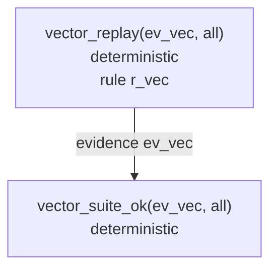
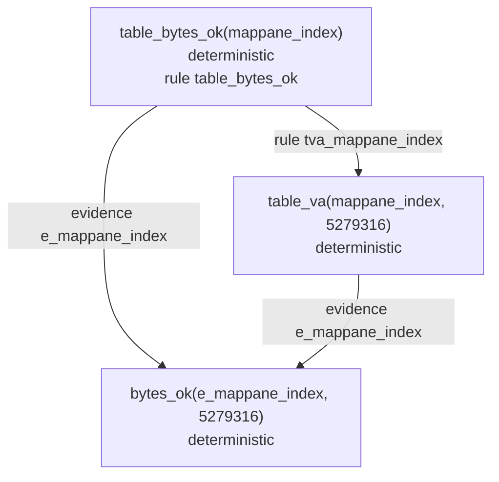

# deg-nexustk — demo walkthrough

A numbered end-to-end tour of the adapter. Steps 1–2 run anywhere against the
committed synthetic fixtures. Steps 3–4 replay **real operator-local
material** — the NexusTK client binary and the emulator checkout at
`/home/kin/nexustk-emulator` — and are never committed, never copied into this
repository, and never run in CI. The outputs pasted here are from one machine
on one day; on another machine they will differ or the lane will fail outright
when the operator-local files are absent.

## 1. Build

```console
$ cargo build
```

`deg-nexustk` depends only on the DeG core, pulled as a git dependency from
`https://github.com/Sureiya/deg` (`main` branch, pinned in `Cargo.lock`). No
crates.io dependencies.

## 2. Synthetic fixtures — check, explain, seal

The committed fixtures under `examples/synthetic/` are generated by an
independent Python implementation of the documented 7.52 algorithms
(`python3 tools/gen_fixtures.py`, deterministic and idempotent — two runs
leave a clean tree). The model proves a vector replay, a frame fact, and a
bundle verification against them.

```console
$ cargo run -q -- check examples/synthetic/model.dg
deg check examples/synthetic/model.dg
  artifacts   5 (5 verified)
  evidence    3 (3 ok)
  claims      3 sealed, 0 provisional, 1 hypothesis, 0 failed/refuted
  obligations 0 open
  conflicts   0 (0 unresolved)
  decisions   0 (0 ok)
  threshold   deterministic

claims:
  ✓ C_adapter                    sealed       deterministic  adapter_sealed(ntk_syn)
      bottleneck: P_vectors
  ✓ P_bundle                     sealed       deterministic  bundle_seen(ev_bundle, bnd_deg_synthetic_752)
  ? P_frames                     hypothesis   observational  frame_seen(ev_frames)
      note: strength observational is below the seal threshold deterministic
  ✓ P_vectors                    sealed       deterministic  vector_replay(ev_vec, all)

kernel: OK
```

The derivation of `P_vectors` as a Mermaid flowchart (the new core flag
`deg explain --mermaid`):

````console
$ cargo run -q -- explain examples/synthetic/model.dg P_vectors --mermaid

````

The three registered evidence kinds:

```console
$ cargo run -q -- extensions
ntk_bundle
ntk_frames
ntk_vector
```

Seal it (the lock is deterministic; the committed copy is byte-identical to a
fresh run):

```console
$ cargo run -q -- seal examples/synthetic/model.dg --out /tmp/show.lock.json
sealed 3 claim(s) (0 provisional) into /tmp/show.lock.json
recorded 1 hypothesis/hypotheses: P_frames
```

```json
{
  "artifact_count": 5,
  "model": "examples/synthetic/model.dg",
  "deg_version": "0.1.0",
  "seal_threshold": "deterministic",
  "sealed": ["C_adapter", "P_bundle", "P_vectors"],
  "hypotheses": ["P_frames"],
  "obligations": []
}
```

## 3. Real artifacts — generate, check, crosscheck, port

Generate a model from the emulator project's audit files (read in place; only
`--out` is written):

```console
$ cargo run -q -- generate \
    --client /home/kin/.local/share/kazetk/vanilla-client/NexusTK.exe \
    --dispatch /home/kin/nexustk-emulator/docs/analysis/opcodes/DISPATCHER-AUDIT.json \
    --layouts /home/kin/nexustk-emulator/ops/conductor/opcode-layouts.json \
    --artifacts /home/kin/nexustk-emulator/docs/analysis/opcodes/artifacts.json \
    --vectors /home/kin/nexustk-emulator/server/internal/protocol/testdata/vectors/7.52.json \
    --out /tmp/opencode/ntk-readme
```

The generated model checks with 46 sealed proofs, 10 hypotheses, and 54 open
obligations:

```text
deg check /tmp/opencode/ntk-readme/model.dg
  artifacts   5 (5 verified)
  evidence    21 (21 ok)
  claims      46 sealed, 0 provisional, 10 hypothesis, 0 failed/refuted
  obligations 54 open
  conflicts   0 (0 unresolved)
  decisions   0 (0 ok)
  threshold   deterministic
```

The coverage claim reports the graph instead of deciding it:

```text
claims:
  ? C_cov                        hypothesis   deterministic  coverage(ds_ops, target:82)
      note: covered 28/82; missing: 0x1, 0x6, 0xe, 0xf, 0x12, 0x1a, 0x1d, 0x21, 0x22, 0x23, 0x24, 0x25, 0x26, 0x29, 0x30, 0x32, 0x34, 0x37, 0x3a, 0x3b, 0x3f, 0x40, 0x42, 0x43, 0x44, 0x45, 0x46, 0x4a, 0x4d, 0x4f, 0x50, 0x51, +22 more
      bottleneck: P_op_00
      coverage: 28/82 covered; missing: 0x1, 0x6, 0xe, 0xf, 0x12, 0x1a, 0x1d, 0x21, 0x22, 0x23, 0x24, 0x25, 0x26, 0x29, 0x30, 0x32, 0x34, 0x37, 0x3a, 0x3b, 0x3f, 0x40, 0x42, 0x43, 0x44, 0x45, 0x46, 0x4a, 0x4d, 0x4f, 0x50, 0x51, +22 more
```

The `--mermaid` derivation of one sealed dispatch-table proof:

````markdown

````

Nine decision templates, one per artifact id:

```console
$ ls /tmp/opencode/ntk-readme/decisions/
79.txt
80.txt
93.txt
96.txt
9b.txt
a0.txt
aa.txt
fe.txt
ff.txt
```

The parity crosscheck — the project files' own ids next to DeG's numbers:

```text
crosscheck parity table (informational; the DeG check itself passed)
==============================================================================
coverage: 28/82 covered
missing (from the layouts universe): 0x1, 0x6, 0xe, 0xf, 0x12, 0x1a, 0x1d, 0x21, 0x22, 0x23, 0x24, 0x25, 0x26, 0x29, 0x30, 0x32, 0x34, 0x37, 0x3a, 0x3b, 0x3f, 0x40, 0x42, 0x43, 0x44, 0x45, 0x46, 0x4a, 0x4d, 0x4f, 0x50, 0x51, 0x57, 0x5e, 0x5f, 0x60, 0x61, 0x64, 0x66, 0x67, 0x69, 0x74, 0x75, 0x77, 0x79, 0x7b, 0x80, 0x93, 0x96, 0x9b, 0xa0, 0xaa, 0xfe, 0xff
layouts file ids: 82 distinct
artifact ids (9): 0x79, 0x80, 0x93, 0x96, 0x9b, 0xa0, 0xaa, 0xfe, 0xff
artifact ids present in the layouts universe: 0x79, 0x80, 0x93, 0x96, 0x9b, 0xa0, 0xaa, 0xfe, 0xff
sealed claims: 46; hypotheses: 10; obligations: 54
==============================================================================
```

The new core flag `deg port --markdown`: a scratch copy of the generated model
adds a second build declaration over the same operator client, so the
table-byte proofs port (`reused`) while the vector and artifact claims are
flagged for revalidation:

```text
# DeG port report — `/tmp/opencode/ntk-port-demo/model.dg` → `ntk2`

## Mappings

| Kind | Name | Old | New | Similarity | How |
|---|---|---|---|---|---|

## Claims

| Claim | Source build | Action | Status | Strength | Notes |
|---|---|---|---|---|---|
| `P_art_79` | `ntk` | stale | stale | - | stale: `e_art`: table evidence is dataset-bound; revalidate it against a target dataset |
| `P_mappane_index` | `ntk` | reused | ported | deterministic → deterministic |  |
| `P_op_00` | `ntk` | stale | stale | - | stale: `e_vec`: extension evidence cannot be ported automatically; re-derive it for the target build |
… the remaining 52 claim rows elided; the full report ends with one `revalidate` obligation per stale claim …
```

## 4. Env-gated cross-checks against operator-local files

Two `#[ignore]`d library tests replay real material when pointed at it by
environment variables. They are never required by CI and never commit data.

Known-answer vectors — the full 7.52 vector suite replayed against the real
file:

```console
$ NTK_VECTORS=/home/kin/nexustk-emulator/server/internal/protocol/testdata/vectors/7.52.json \
    cargo test --lib -- ntk_real_vectors --ignored
running 1 test
test vectors::tests::ntk_real_vectors ... ok

test result: ok. 1 passed; 0 failed; 0 ignored; 0 measured; 38 filtered out; finished in …s
```

A sealed `kaze.bundle/v1` package — manifest, index pin, evidence file, and
blobs verified:

```console
$ NTK_BUNDLE=/tmp/opencode/captures/sealed/bundles/bnd_board_empty_5 \
  NTK_BUNDLE_INDEX=/tmp/opencode/captures/sealed/index.json \
    cargo test --lib -- ntk_real_bundle --ignored
running 1 test
test bundle::tests::ntk_real_bundle ... ok

test result: ok. 1 passed; 0 failed; 0 ignored; 0 measured; 38 filtered out; finished in …s
```

## Keeping the docs honest

The synthetic excerpts in this walkthrough and in `README.md` are re-run and
diffed byte-for-byte by `tools/verify_readme.py`. If a code change alters any
of them, re-capture the output and update the docs in the same commit.
